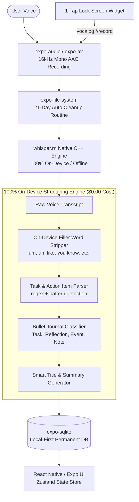

# VocaLog: 100% Offline, Zero-Cost AI Voice-to-Journal App

A 100% private, zero-cloud, zero-variable-cost mobile application built with **React Native (Expo SDK 52+ with TypeScript)** that converts voice reflections into structured journal entries entirely on-device.

---

## 1. Zero-Cost, 100% Offline Architectural Overview

---

## 2. Retention Model & Future Pro Tier Architecture

### 2.1 Initial Release (v1.0)
* **Default Audio Retention:** **21 Days**.
* All recorded `.m4a` audio files older than 21 days are automatically pruned from local storage to conserve phone space.
* **Text & Notes Permanence:** Text transcripts, cleaned prose, titles, summaries, and action items are saved in SQLite forever.

### 2.2 Future Pro Tier Expansion
* **Pro Tier Feature:** **Configurable Audio Retention Settings**.
  - Free/Standard users: Fixed at **21 Days**.
  - Pro subscribers ($4.99/mo): Unlocks custom retention options (e.g., **7 Days**, **14 Days**, **21 Days**, **60 Days**, **90 Days**, or **Keep Forever / Never Delete**).
* **Architecture Preparation:** The `StorageCleanupService` and user settings store will be architected with a dynamic `retentionDays` parameter from Day 1 (defaulting to 21), allowing seamless gating behind a Pro entitlement flag in the future.

---

## 3. Revised 5-Phase Implementation Breakdown

### **Phase 0: Local Environment, Toolchain & Native SDK Setup** (Completed)
> **Goal:** Ensure all required compilers, runtimes, package managers, and development tools are installed and operational on this machine before writing project code.

* [x] Verify Node.js (v22.14.0) and npm (v11.3.0).
* [x] Verify native C++ toolchain (`clang`, `gcc`, `make`, `cmake`) needed for compiling `whisper.cpp`.
* [x] Configure Android SDK environment variables (`ANDROID_HOME`, `platform-tools`).
* [x] Initialize clean React Native Expo project with TypeScript template.
* [x] Configure `app.json` with brand logo assets:
  - App icon: `assets/logo/ios_app_icon_1024.png`
  - Android adaptive icon: `assets/logo/android_adaptive_foreground_512.png` & background `android_adaptive_background_512.png`
  - Splash screen: `assets/logo/CleanedLogoOnly.png` on dark slate background (`#0F172A`)
  - URL scheme: `vocalog`
* [x] Configure `tsconfig.json` for strict type-checking and path aliases (`@/*`).
* [x] Verify the project starts cleanly with `npx expo config` and passes `npx tsc --noEmit`.

### **Phase 1: Local Audio Recording, 21-Day Retention Cleanup & SQLite Database** (Completed)
> **Goal:** Zero-cloud recording, automated disk management with 21-day threshold, and persistent local storage.

* [x] Install core libraries: `expo-sqlite`, `expo-file-system`, `expo-av`, `lucide-react-native`, `zustand`, `date-fns`.
* [x] Implement `DatabaseService` using `expo-sqlite`:
  - Table `entries` with date indexing (`idx_entries_created_at`).
  - User settings table with configurable `retention_days` (default = 21).
  - CRUD operations (insert, query all, query by id, delete, clear audio path).
  - Expiration queries: `getEntriesOlderThan(cutoffTimestamp)`.
  - Daily date-range query: `getEntriesForDate(date)` filtered by 00:00:00–23:59:59 and ordered latest time first (`ORDER BY created_at DESC`).
* [x] Implement `AudioRecorderService`:
  - 16 kHz mono AAC recording configuration (optimal for Whisper).
  - Recording permissions, duration timer, and audio file path resolution.
* [x] Implement **21-Day Local Audio Auto-Cleanup Routine**:
  - Scans recordings directory on app launch and post-recording.
  - Safely deletes `.m4a` files older than **21 days** (configurable via parameter for future Pro tier).
  - Sweeps orphaned files with no DB record.
* [x] Write unit tests for audio recorder, cleanup execution, and data layer (18/18 tests passing across 4 suites in Jest).

### **Phase 2: 100% On-Device Offline Whisper Speech-to-Text Engine & Zero-Cost Structuring Pipeline** (Completed)
> **Goal:** Run native C++ speech recognition without internet access, and clean/structure entries on-device with zero cloud costs.

* [x] Install and configure `whisper.rn` native C++ bindings.
* [x] Implement `WhisperTranscriptionService`:
  - Default GGML model resolution (`ggml-tiny.en.bin` in `models/`).
  - Context caching, transcription with progress, and clean memory release.
* [x] Implement `TextStructuringService` ($0.00 zero-cost local NLP engine):
  - Intelligent verbal filler word removal (`um`, `uh`, `er`, `like`, `you know`, `sort of`, `kind of`, `basically`, etc.).
  - Sentence capitalization, whitespace normalization, and punctuation cleanup.
  - Bullet Journal categorization (`Task`, `Reflection`, `Event`, `Note`).
  - Action item extraction converting imperative speech patterns into checklist items.
  - Concise title (3–6 words) and executive summary synthesis.
* [x] Implement `JournalPipelineService`:
  - Complete end-to-end pipeline orchestrating audio transcription -> text structuring -> SQLite database persistence.
* [x] Write comprehensive unit test suite: 40/40 tests passing across 7 test suites in Jest.

### **Phase 3: Dark Slate UI, Daily Feed with Date Navigation & Audio Playback** (Completed)
> **Goal:** Deliver a sleek, modern, high-contrast dark theme interface with date-by-date timeline navigation and smooth recording interactions.

* [x] Create dark slate/teal design system (`#0F172A`, `#1E293B`, `#2DD4BF`).
* [x] Integrate in-app brand logo (`assets/logo/CleanedLogoOnly.png`) into app bar header.
* [x] Build **Date Navigator Header**:
  - Displays selected date (e.g. *"Today — Thursday, Oct 22"*).
  - Left arrow (`<`) to navigate to previous day's notes.
  - Right arrow (`>`) to navigate to next day's notes.
  - "Today" quick-jump chip when viewing past dates.
* [x] Build **Daily Feed Screen**:
  - Filters entries strictly for the selected date, sorted in **reverse-chronological order (latest time first)**.
  - Sub-header displaying note count and total recording time for the day.
  - Sleek minimalist empty state when navigating to days without notes.
* [x] Build 1-Tap Floating Record button with animated sound-wave pulse and live timer.
* [x] Build Entry Detail modal:
  - Toggle between "Cleaned Prose" and "Raw Transcript".
  - Audio player for recordings under 21 days old (displays "Audio stored for 21 days").
  - Action item checkboxes and interactive toggle.
* [x] Write unit tests for Zustand store and UI interactions (49/49 tests passing across 8 test suites in Jest).

### **Phase 4: Lock/Home Screen Widgets, Settings, Data Export & Monetization** (Completed)
> **Goal:** Eliminate entry friction with 1-tap widgets, provide full local data export ownership, and set up RevenueCat subscription management.

* [x] Configure custom URL schemes (`vocalog://record`, `vocalog://settings`, `vocalog://today`) and deep link listener in `src/core/services/DeepLinkService.ts`.
* [x] Implement complete data ownership export engine (`DataExportService.ts`) for JSON archives and Markdown documents with native file sharing (`expo-sharing`).
* [x] Build `SettingsModal.tsx` with audio retention period configuration (7, 14, 21 Days default, 60 Days, Keep Forever) and data export triggers.
* [x] Implement `SubscriptionService.ts` and `PaywallModal.tsx` wrapping `react-native-purchases` for **$4.99 / month** Pro subscriptions with 3-day free trial.
* [x] Unit tests for deep linking, data exports, and subscription management (75/75 tests passing across 11 test suites in Jest).
* [x] Complete Metro Android bundling check verified (`EXPO_NO_TELEMETRY=1 npx expo export --platform android`).

### **Phase 5: Native Android/iOS Quick-Access Widgets, Lock Screen Tile & App Shortcuts** (Completed)
> **Goal:** Provide seamless 1-tap recording directly from the lock screen, notification shade, and desktop widgets across mobile platforms.

* [x] Implement Android Quick Settings Tile (`QuickRecordTileService.kt`): Pull down from lock screen and tap "Record Note" to trigger instant audio capture.
* [x] Implement Android 1-Tap Home Screen Widget (`QuickRecordWidgetProvider.kt` & `widget_quick_record.xml`): 1x1 circular widget with dark slate and neon teal styling.
* [x] Configure Android App Shortcuts (`shortcuts.xml`): Static shortcuts for Record (`vocalog://record`) and Today's Feed (`vocalog://today`), assignable as lock screen corner shortcuts on Android 14/15.
* [x] Add dynamic Safe Area status bar insets (`DailyFeedScreen.tsx`) for Android edge-to-edge / hole-punch screens.
* [x] Create comprehensive setup guides for users: `docs/WIDGETS_AND_SHORTCUTS_GUIDE.md` (Android & iOS) and tabbed in-app `HelpGuideModal.tsx`.
* [x] Update App Store and Google Play metadata (`docs/APP_STORE_METADATA.md`) with widget and lock screen capabilities.

---

## 4. Financial Breakdown & Unit Economics

| Metric | Amount | Details |
| :--- | :--- | :--- |
| **Audio Transcription** | **$0.00** | 100% processed locally on user's device via `whisper.cpp` |
| **AI Text Formatting & Cleaning** | **$0.00** | 100% processed locally via on-device NLP structuring engine |
| **Cloud Servers & Database** | **$0.00** | Local-first SQLite on device |
| **Total Variable Cost Per User** | **$0.00** | **Infinite scalability with zero infrastructure costs** |
| **Subscription Price** | **$4.99 / month** | Straightforward, single-tier pricing |
| **Net Gross Margin** | **85%** ($4.24/user/mo) | Standard Apple/Google 15% Small Business Program cut |
